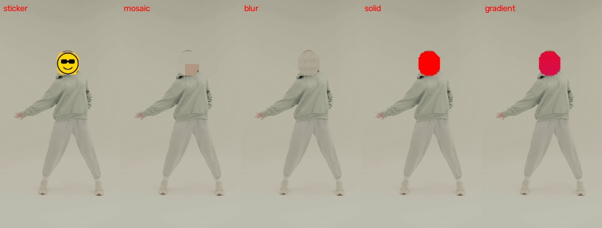
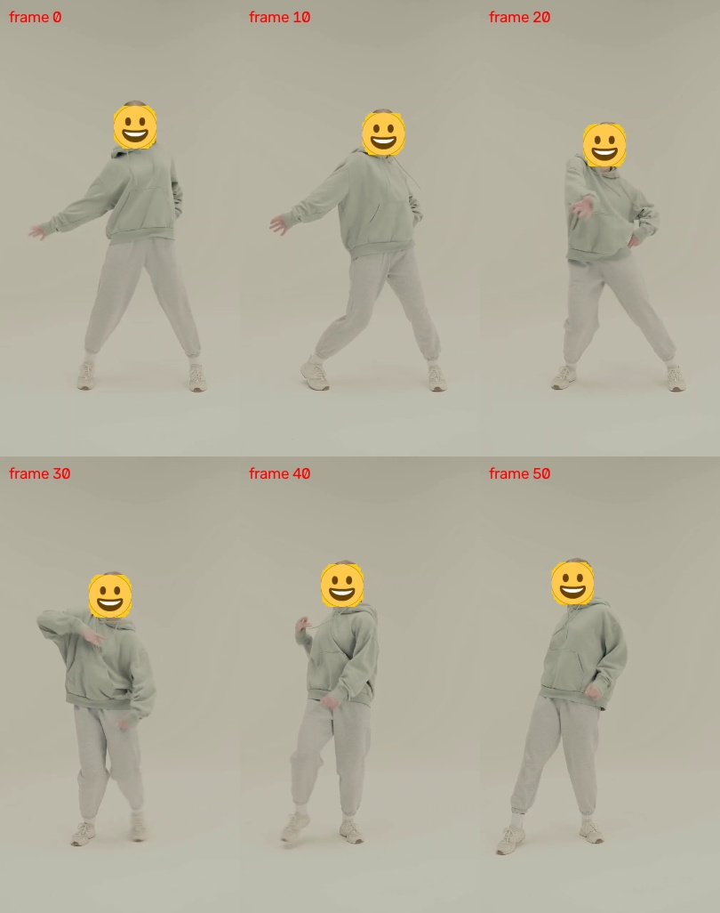

# 隐私打码真机测试记录 — 2026-11-04

状态：本轮 Android 单机测试已完成。结论：不通过隐私验收，存在多人漏遮、连续处理失败和精确裁剪尾帧丢失问题。

| 检查层 | 结果 |
| --- | --- |
| 现有 Flutter 相关测试 | 118 / 118 通过 |
| 现有 Android JVM 测试 | 544 / 545 通过 |
| 选定 Android 真机仪器测试 | 31 / 39 通过，8 项失败，无剩余未完成项 |
| 新增网络素材原生导出 | 13 个任务完成，画面质量另行判定 |
| 主应用任务生命周期 | 3 个任务完成、1 个长任务主动取消、1 个处理中任务终止后恢复为 interrupted；复现后续处理失败 |
| 成片结构检查 | 16 个独立视频、全部 802 帧可解码，PTS 严格递增，无全黑/全绿损坏帧，均有有效 ftyp/moov/mdat 且支持 fast start |

上表中编码任务完成、媒体结构有效，不代表每个隐私目标都被完整遮挡。

## 环境与素材

- 真机：OnePlus 8T / KB2000，Android 14，ADB 序列号 `334da6a3`。
- 主应用：`art.gaoge.dance`，0.1.0 / versionCode 1，Debug，2026-11-04 11:58 安装。
- 已安装主应用与工作区现有 `app-debug.apk` 的 SHA-256 完全一致：`1b8d246de608d81ef813792f427806a386d2964083bdbb33a4ed14b9294b5669`，见 `apk-baseline.json`。本轮没有重新安装产品 APK；真机仪器测试 APK 从当前代码构建并安装。
- 仓库 HEAD：`9ef3d23bc7cb1f2823fef3d61a7e74e0246069b1`，工作区已有未提交界面改动，清单见 `preexisting-dirty-files.txt`。
- 原有产品源码未为本轮测试修改；新增一个显式 opt-in 的 Android 网络素材测试入口，保留输入参数与导出视频。
- 只操作本次公开素材及本应用数据；未对外发送视频或诊断包，分享仅验证系统面板可打开。
- 公开素材、下载来源、字节大小和 SHA-256 见 `sources.json`。视频包括双人横屏、多人镜面横屏、单人竖屏及其不同分辨率版本，以及无人物花朵视频；另有透明自定义贴纸。损坏输入由本次双人素材复制前 1024 字节生成。
- 设备素材目录：`/sdcard/Movies/WoahPrivacyQA/`，贴纸与损坏输入位于 Download 下的 `WoahQA-*` 文件。

素材网页：

- [双人舞 / Pavel Danilyuk](https://www.pexels.com/video/couple-dancing-in-the-dance-studio-6940536/)
- [单人竖屏舞 / Antoni Shkraba](https://www.pexels.com/video/woman-dancing-7570258/)
- [多人镜面舞 / Kampus Production](https://www.pexels.com/video/women-dancing-in-the-studio-8956295/)
- [MDN 无人物测试视频](https://interactive-examples.mdn.mozilla.net/media/cc0-videos/flower.mp4)
- [Twemoji 自定义贴纸](https://github.com/twitter/twemoji/blob/master/assets/72x72/1f600.png)，图形按其 CC-BY 4.0 许可使用，未修改。

## 已确认问题

### P0：多人主体跟随导出仍暴露背景人物面部

复现：重启应用 → 导入 `group-hd-8956295.mp4` → 沿用人脸保护 → 画幅 9:16 → 选择右侧蓝色上衣人物为主角（界面人物 7）→ 保留其他默认保护对象 → 剪辑终点约 3.0 秒 → 导出。

界面显示“主角：人物 7 · 保护 4 人”。导出完成、相册保存成功，但主角后方黑色服装舞者面部仍可见。

- 画面证据：`group-follow-last-frame.jpg`、`export_1793774210039-contact.jpg`。
- 原始视频：`export_1793774210039.mp4`。
- 原始分析：`group-analysis.json`，检测到 7 个 ID；ID 5 对应后方人物，置信度 `0.34719809889793396`。
- UI 只保留置信度不低于 0.60 的人物，呈现 ID 1、2、3、4、6；未提供这个低置信度人物的可选目标。
- 导出诊断：`group-follow-native-summary.json`，实际 `face_only_ids=[1,2,3,4]`，主角 ID 6；不是简单的保存或播放器问题。
- 全身全部 7 ID 的原生测试也保留在 `group_full_solid.mp4`，重叠人物仍存在局部身体未被色块覆盖的画面；不能以编码任务成功认定遮罩完整。

### P1：完成或取消一次导出后，后续预览和重新导出失败

复现一：双人全身色块导出完成 → 返回首页 → 导入单人竖屏视频 → 效果预览持续报“暂时无法更新” → 导出失败 → 重试仍失败。

复现二：单人视频开始导出 → 进入后台并返回 → 确认取消 → 保留编辑参数 → 缩短终点至 3.5 秒 → 再次导出失败。

重启应用后，同一 HD 视频效果预览恢复正常。故障同时发生在高分辨率和 HD 输入，不能仅归因为 4K 解码不支持。

- 截图：`solo-hd-after-export.png` 与 `solo-hd-after-restart.png` 对照，`solo-retry-failed.png`、`cancelled-reexport.png`。
- `export-jobs.json`：首次全身任务 completed，长任务 cancelled（475/662），失败重试没有新增成功任务。
- 取消的半成品未留在 exports 目录，已有成片保留。
- 资源交接是待进一步定位方向；本记录不把未证实的内部原因作为结论。

### P1：含 B 帧素材裁剪后缺少末尾视频帧

网络素材测试请求源区间 `[0,1600ms)`，源 25fps、源起始 PTS 为 0：

- 单人视频：应含源帧 0–39，实际导出 38 帧 / 1.52 秒，AAC 音频 1.60 秒，差 80ms。
- 五种人脸样式均复现。
- `solo-frame-correspondence.json` 将导出身体区域与原视频逐帧匹配，输出对应源帧 0–37，缺源帧 38、39；匹配 MAE 约 1，排除了只因文件统计口径不同导致的差异。
- 多人视频全身导出同一区间实际 37 帧 / 1.48 秒；源存在更多重排 B 帧。
- 任务回调 reported frames 不等于实际封装帧数，必须检查 MP4。
- 证据：各样式 MP4、`media-inspection.json`、`solo-frame-correspondence.json`。

## 测试证据与边界

### 界面操作

已验证：首页视频保护 → 系统素材选择 → 读取规格 → 自动识别人 → 全身/人脸模式 → 目标清空与恢复 → 五种人脸样式 → 自定义透明 PNG 贴纸 → 强度调节并恢复 100% → 裁剪起止点 → 起点改变后重新识别并要求确认 → HD 输出 → 9:16 主角选择 → 导出进度 → 后台前台服务 → 取消确认的继续/取消分支 → 取消后返回编辑 → 保存相册 → 系统播放器 → 系统分享面板。

人脸样式实际预览对照：`face-preview-contact.jpg`；自定义贴纸：`custom-sticker-preview.png`。

最后在新进程用 2160×4096 原素材完成自定义贴纸全流程：原始画幅、约 2 秒裁剪、HD 输出、保存相册。成片 `export_1793775355926.mp4` 为 674×1280 / 25fps，51 帧、2.04 秒，AAC 音轨 2.005333 秒，轨时长差约 34.7ms；六帧检查能看到导入的自定义笑脸跟随面部。诊断 `highres-native-summary.json` 明确记录输入 2160×4096。高分辨率本身在这次独立运行中可用。





后台服务证据：本次长任务在后台 `isForeground=true`，返回后任务仍推进。取消后任务落为 cancelled，`outputUri=null`。

进程中断也在真机复现：专用任务 `job_dd0b8ace-a152-4165-a12e-b8e1274576be` 从 processing（256/662、约 38.5%）被终止，重启后变为 interrupted / `EXPORT_INTERRUPTED` / `outputUri=null`，应用返回首页。前后记录为 `interruption-before.json` 与 `interruption-after.json`。没有发布到系统相册；缓存中留有本次任务的 1.4MB `.tmp.mp4`，本轮记录后仅清理这一个测试临时文件。未等待后续缓存 TTL 清理，不能据此判定缓存泄漏。

性能只作为本设备观测：双人 186 帧导出约 50.1 秒，原生报告约 3.73fps；多人 9:16 任务约 26.8 秒、原生报告约 2.85fps；高分辨率短任务约 16.5 秒。新网络用例的总耗时包含分析、模型初始化和编码，不应用它直接推导稳定编码 FPS。

### 自动检查

- Flutter 相关现有测试：118/118 通过，日志 `flutter-tests-elevated.txt`。
- Android JVM：545 项，544 通过、1 失败，日志 `android-tests-build.txt`；失败是 `DiagnosticPrivacyTest.actualZipRedactsHistoricTextPreservesQualityAndRejectsSourceLinks` 第 160 行符号链接排除断言。该结果来自本机 Windows JVM/Robolectric，不能直接当成 Android 发布版泄露结论。
- 原有真机完整人脸导出 3 项均失败，断言未发现预期黄色贴纸。其请求为 solid / faceStickerEnabled=false / stickerAssetId=null；当前产品支持多种人脸样式，而显式请求贴纸的网络素材能生成贴纸，因此需要核对旧测试与当前样式契约，不将黄色像素断言失败直接等同为裸脸暴露。
- 原有真机仪器测试最终补齐 39 项：31 通过、8 失败、0 超时。4 项失败与旧版黄色贴纸预期有关；3 项是 LOST / dormant 状态恢复断言失败；1 项是 300 帧性能门槛失败（p95 67.127ms，门槛 40ms）。该 300 帧用例本身完成了全部帧，检测 300、fallback 0、unresolved 0、rejected 0，不能把性能失败误报成其遮罩未解析。统计见 `face-stress-telemetry.txt`、`test-summary.json`。
- 早期组合运行长时间无进展，由测试执行者结束并改为逐用例隔离执行；所有选定用例已有最终结果。旧日志中的 Process crashed 是主动结束测试进程的结果，不能当成产品崩溃。
- 素材选择取消返回首页；无人物素材提示“没有找到可保护的人物”，重新识别后仍正确提示；损坏 MP4 提示“无法读取所选视频，请换一个重试”并保留原项目。证据分别为 `cancel-picker-returned.png`、`no-person-result.png`、`no-person-retry.png`、`corrupt-error-toast.png`。
- 新增网络素材矩阵 12/12 加单独显式人脸贴纸用例，共 13 个原生导出任务完成；见 `network-case-results.json`、`network-solo-face-sticker.txt`。其 passed 只表示真实分析与编码导出完成、产物存在，最终隐私质量由视频画面和附加检查判定。五种人脸成片对照见 `face-export-styles.jpg`。

检查工具 `inspect_media.py` 使用 FFprobe / OpenCV 读取全部导出视频帧，验证尺寸、帧数、解码 PTS 单调性、黑/绿损坏帧、音视频轨时长和 MP4 atoms，并生成六帧联系表。结构检查不能证明所有人所有帧均已打码。

## 复现入口

`NetworkPrivacyWorkflowInstrumentedTest.kt` 默认在未提供 `-e case` 时跳过，不影响没有网络素材的常规测试。示例（先将素材放入测试包 external files 下的 network_privacy_qa）：

```text
adb shell am instrument -w -r \
  -e class art.gaoge.dance.engine.pipeline.NetworkPrivacyWorkflowInstrumentedTest \
  -e case solo_face_sticker -e input solo-hd-7570258.mp4 \
  art.gaoge.dance.engine.test/androidx.test.runner.AndroidJUnitRunner
```

其他参数：`fill`、`faceOnly`、`startMs`、`endMs`、`width`、`height`、`profile`、`select`。本轮批量入口为 `run_network_cases.py`。

尚不能由本轮单机证据覆盖：iOS、发布 APK、不同芯片兼容性、4K60/HDR/HEVC/VFR 全格式组合，以及有逐帧人工标注的 MOTA/IDF1/零曝光率认证。

## 后续修复顺序

1. 先处理多人漏遮，覆盖被 UI 过滤的低置信度真实人物与重叠人体；需要保留可审查选择或保守保护机制。
2. 修复完成/取消后的原生资源交接，加入同进程连续导出和“取消后立即重试”的真机回归。
3. 修复精确裁剪边界的重排帧处理，按实际封装的帧和 PTS 校验尾帧、音视频时间线。
4. 区分旧贴纸测试契约、真实 LOST/dormant 回归及设备性能门槛，逐项修复失败；不删除或降低断言来获得绿色结果。


## 归档范围

Git 保存本报告、结构化结果、关键测试日志和选定帧证据。下载原片、完整成片、UI 抓屏、调试媒体及中间产物保留在本地，不随提交写入仓库；未删除这些文件。完整文件大小与 SHA-256 见 [产物索引](artifact-index.json)。历史记录中的工作区、APK 和测试计数描述测试发生时的状态；最终验收见 [最终回归报告](../privacy-regression-2026-11-04/README.md)。
