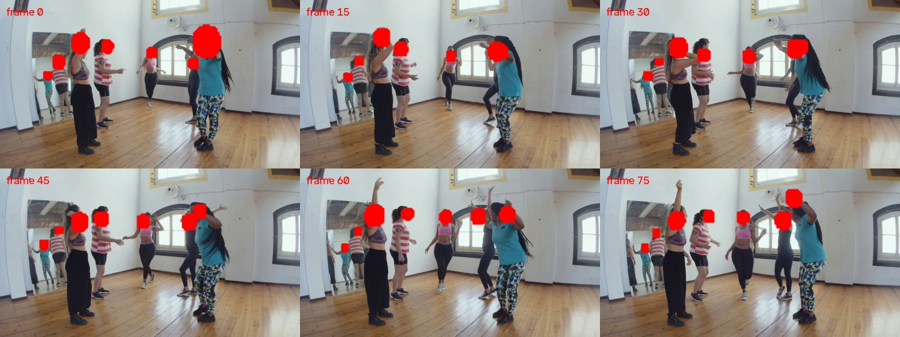
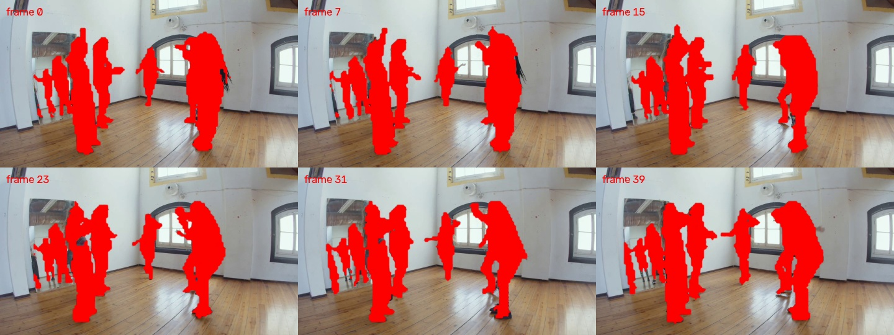
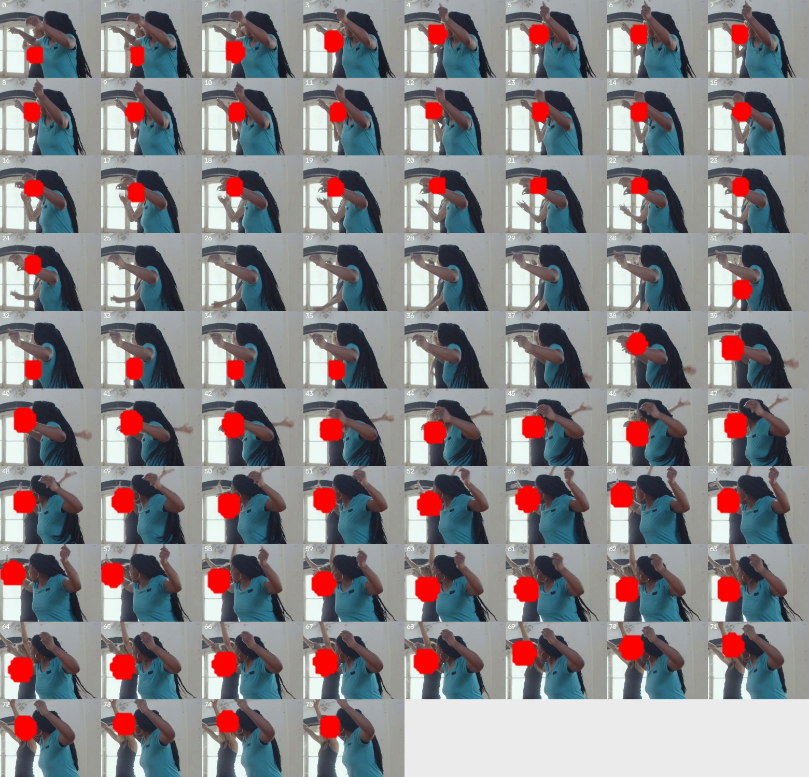
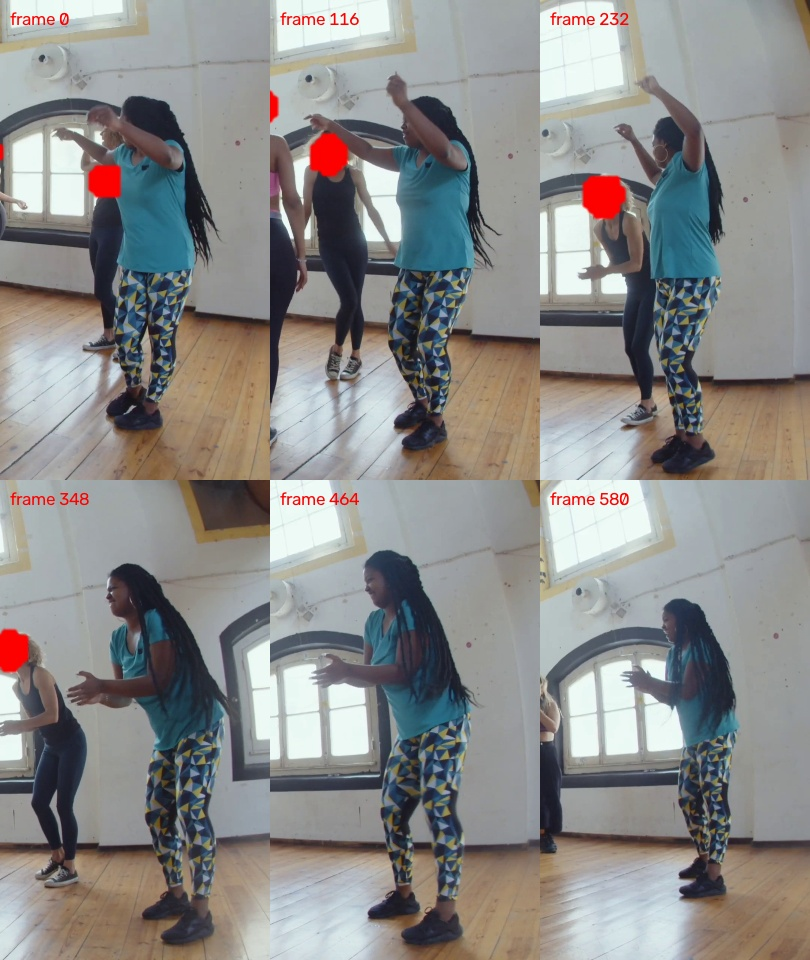
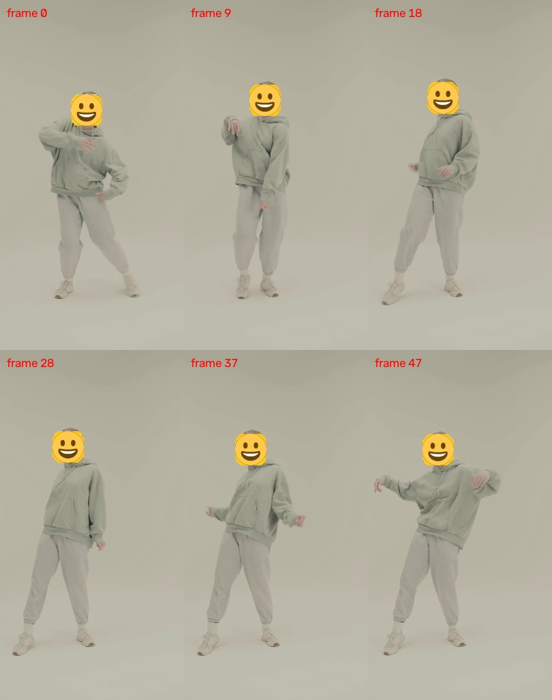

# 隐私打码修复与真机回归 — 2026-11-04

状态：三项问题已修复并完成同批素材真机回归。对应复现与新增回归通过；既有的 1 项 JVM 和 8 项真机测试失败仍保留，未计作通过。

## 修复内容

1. **多人漏遮**
   - 移除 Flutter 人物候选的二次 0.60 置信度过滤；保留原生已经检出的低置信度遮挡人物，默认纳入保护。缓存恢复也不再丢弃该目标。
   - 人脸定位使用原始分辨率视频纹理；640px YOLO 诊断输入不再进入成片的人脸像素路径。
   - 宽 ROI 中的人脸必须落在所属人物的合理头部范围内，防止相邻两个人的遮罩都落到同一张脸上。
   - 人脸合成不再用未保护人物的粗全身分割反向扣除人脸遮罩，避免交叠时在人脸区域挖出透视孔洞；全身保护仍保留其原有前景遮挡策略。
   - 全身遮罩回退使用实际轮廓像素覆盖判断重复，不再因两名已保护人物的包围框重叠而丢弃后排人物独有的身体轮廓。对未保护人物的严格几何限制保留。
   - 质量模式和人物预览采用与选人分析一致的 CPU 后端，质量导出使用 4 线程；均衡、速度模式保留原有后端选择。
   - 全身保护和多人场景逐帧检测，避免速度模式用旧轮廓预测移动肢体时短暂漏遮。单人人脸模式保留原加速节奏。这会增加全身/多人快速模式的处理时间。
2. **完成/取消后不能连续导出**
   - `AtomicReference.compareAndSet` 比较对象引用；服务从 Intent 取出的任务 ID 字符串与预约字符串内容相同、对象不同，导致原预约永久残留。
   - 归还时先按任务 ID 内容确认所有权，再用原子引用中真实存储的对象执行 CAS。仍等待实际 worker 和模型释放，不在取消通知时提前放开通道。
3. **B 帧裁剪丢失尾帧**
   - 不再以压缩包的 PTS 提前停止解码输入；B 帧可能依赖裁剪终点之后的参考包。
   - 按解码后画面的 PTS 执行 `[起点, 终点)` 裁剪，输出仍不包含区间之外的画面。

## 环境与素材一致性

- OnePlus 8T / KB2000，Android 14，ADB `334da6a3`。
- 主应用 `art.gaoge.dance`，Debug 0.1.0，target SDK 36。
- 修复版已安装到真机。安装 APK 与最终本地 APK 的 SHA-256 一致：`9a76459519bd5f1efa624c402a6256375470b21c1959b7685764d6de9a91ba1c`，见 [环境记录](environment.json)。APK 为 `mobile/app/build/app/outputs/apk/debug/app-debug.apk`。
- 使用上一轮下载的同一批双人、单人 HD/4K、多人 HD/4K、无人花朵、损坏视频和透明 PNG 贴纸。来源与许可见 [素材记录](../privacy-e2e-2026-11-04/sources.json)。全部 8 个文件的真机 SHA-256 已与上一轮逐个核对，未替换素材。
- 原始 QA 与修复前证据保留在 [上一轮报告](../privacy-e2e-2026-11-04/README.md)。
- 本轮没有提交或推送代码，也没有向任何分享目标发送视频。

## 自动检查

| 检查 | 结果 |
| --- | --- |
| Flutter 全套 | 272 / 272 通过 |
| Android JVM 全套 | 550 / 551 通过；唯一失败为上一轮已有的 `DiagnosticPrivacyTest.actualZipRedactsHistoricTextPreservesQualityAndRejectsSourceLinks`，Windows/Robolectric 符号链接排除断言，第 160 行 |
| 同批素材生产管线导出 | 22 / 22 通过：19 项样式/规格/裁剪用例、2 项多人均衡/速度模式、1 项 23.24 秒全长多人跟随，见 [汇总](test-summary.json) |
| 同进程真实 API/前台服务生命周期 | 最终 APK 上通过“预览→完成导出→再次预览→取消导出→再次预览和导出→最终预览”，见 [生命周期结果](lifecycle-final.json) |
| 原有隐私相关真机用例 | 最终 APK 上 31 / 39 通过，8 个失败集合与修复前完全相同，无新增失败，见 [逐项结果](final-device-results.json) |
| 成片完整检查 | 24 个视频、1661 帧全部解码；PTS 严格递增，无全黑/全绿损坏帧，全部支持 MP4 fast start，见 [媒体检查](media-inspection.json) |
| 主应用任务 | 2 次导出保存完成、1 次主动取消、1 次主动强停后恢复为 interrupted；无 failed 任务，见 [任务记录](export-jobs.json) |

新增回归覆盖：低置信度人物首次分析与缓存恢复、反序列化后任务 ID 的值所有权、已保护人物重叠时的独立轮廓、宽 ROI 相邻人脸归属、逐帧隐私调度、人脸中心不得被全身前景挖孔。导出用例额外用 `MediaExtractor` 比较裁剪区间内真实源帧数和成片帧数，并断言成片 PTS 严格递增。

最后的人脸合成变更后，重跑全部 12 个受影响人脸素材用例、全长多人用例、实际服务生命周期及 39 项真机用例；未变更的全身路径复用该轮有效成片。Gradle 的整套命令因上表已有 JVM 失败返回非零，但两个 APK 的 assemble/package 任务均完成，最终安装文件已校验并实际运行。

保留的真机失败包括：4 项仍按黄色贴纸断言但请求传入 solid 样式的导出/预览用例、3 项原有人脸休眠/重激活状态断言，以及 300 帧压力测试的检测耗时 p95（本次 75.77ms，阈值 40ms）。未将这些失败改写为通过。

### 尾帧恢复证据

单人 25fps 素材 `[0,1600ms)`：由 38 帧恢复为 40 帧，视频和 AAC 音轨均 1.60 秒。逐帧以未遮挡身体区域匹配源图像，确认对应源帧 **0–39**，末帧 38、39 实际存在；不是重复画面补足帧数。

非零起点 `[1000,2600ms)`：40 帧，对应源帧 **25–64**，视频和 AAC 音轨均 1.60 秒。见 `trim-frame-correspondence.json`。

多人全身同一区间：由 37 帧恢复为 40 帧 / 1.60 秒。全长多人导出为 **581 帧 / 23.24 秒**，末帧 PTS 为 **23.20 秒**，与源文件的区间内帧数一致；测试总耗时 221.03 秒，属于 Debug 设备观测。

### 多人画面证据

最终全员人脸保护首帧已经修复邻脸重复关联；原后排目标仍在保护范围中：

多人全身选择全部七个 ID，后排独有身体轮廓不再因前排重叠而被丢弃：

逐帧孔洞检查：重点跟随片段原有 11 帧内部缺口，修复后为 0。最终检查多人跟随、多人人脸、单人人脸和全长多人共 **773 帧**，内部缺口均为 0，见 [检查结果](privacy-mask-hole-audit.json)。检查针对不透明红色色块，排除 AVC 4:2:0 色度及抗锯齿在外边界 3 像素内的颜色阈值毛刺；同时保留逐帧画面供审看。

## 主应用完整流程

- 最终 APK 从首页导入原 HD 多人素材，展示全部 7 人；选择原蓝衣人物为主角，保留其余 6 人保护，9:16 跟随、约 3 秒裁剪、强度 100%。导出 720×1280、76 帧 / 3.04 秒，并保存至系统相册。
- 不重启应用，返回首页导入原 **2160×4096** 单人素材。预览正常，导入同一透明 PNG 自定义贴纸。长任务在后台继续推进，验证取消弹窗的“继续处理”和“取消处理”两个分支，最终在 **243/662 帧**主动取消，`outputUri=null`，未发布半成品。
- 在原进程中缩短区间并改变起点，重新识别后确认保护，再次导出成功：674×1280、48 帧 / 1.92 秒，AAC 1.941333 秒，音画时长差 21.33ms，低于一帧。裁剪起点改变后的确认保护步骤已实际验证；确认前导出被阻止。
- 上述“完成→新素材预览→取消→重新导出”始终为主应用 **PID 12706**，见 [UI 生命周期证据](ui-lifecycle.json)。没有用重启规避连续处理问题。
- 同一无人花朵素材显示“没有找到可保护的人物”，重新识别后仍正确提示，点击导出不创建任务。同一 1024 字节损坏视频明确提示“无法读取所选视频，请换一个重试”，未创建任务。
- 另起独立公开素材任务，处理到 34/662 帧主动强停应用。重启后为 `interrupted / EXPORT_INTERRUPTED / outputUri=null`，返回首页，已有成片保留。仅清理该任务新建的一个临时文件，见 [强停后状态](interruption-after.json) 与 [清理记录](interruption-temp-cleanup.json)。
- 查看视频和系统分享面板均已打开验证；没有选择接收方或发送视频。无人素材、损坏素材、取消及强停后均可继续回到正常应用入口。

## 边界

本报告验证这一台 Android 真机及这批公开素材，不把任务完成状态等同于任意视频的隐私保证。既有自动测试失败会保留在结果中，不将它们记作通过。

## 归档范围

Git 保存本报告、结构化结果、关键测试日志和选定帧证据。下载原片、完整成片、UI 抓屏、调试媒体及中间产物保留在本地，不随提交写入仓库；未删除这些文件。完整文件大小与 SHA-256 见 [产物索引](artifact-index.json)。历史记录中的工作区、APK 和测试计数描述测试发生时的状态；最终验收见 [最终回归报告](../privacy-regression-2026-11-04/README.md)。
