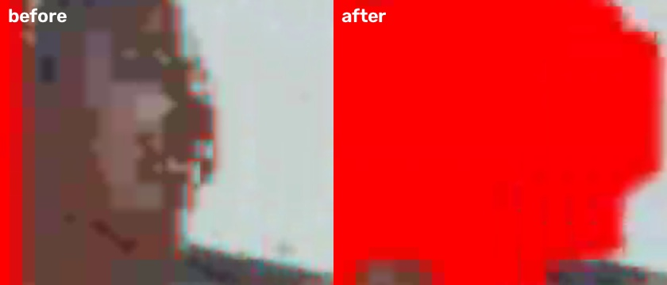

# Rust 共享核心迁移：阶段验证

这是分阶段验证记录，尚非两端 62 项最终验收。固定矩阵为
[`testdata/privacy/matrix.json`](../../testdata/privacy/matrix.json)，沿用原来的八份素材及模型 SHA。

## 独立核心与工具链

- 核心名为 **FrameKernel**，位于 `crates/frame-kernel`；Cargo 包名
  `frame-kernel`、Rust import `frame_kernel`、C ABI `frame_kernel_*`、Clang 模块
  `FrameKernelC`。JNI/Swift 桥位于移动插件中。crate 无 Flutter、Android、Apple
  框架或推理运行时依赖，保留独立 MIT 许可证，目前不发布包。
- Windows/MSVC 与 Mac/Apple Silicon 均使用隔离的 Rust **1.97.1**，保留原有全局环境。
  Android NDK **28.2.13676358**；Android 三种 ABI、Apple 设备及两种模拟器架构均构建。
- 重命名前后，两台主机的 C ABI 几何指纹均为
  `534f5c46ba485af3a11f667bf0edfd8f64dd8c6362fad846fa6c04406f3dc7ff`。
- 已修复 Windows CMake 资源编译器路径转义，以及 CocoaPods 插件符号链接被 Xcode
  规范化后导致头文件路径错误、Rust 源码更新未触发增量编译的问题。

## 几何迁移阶段

PR #21、#22、#23 已合并，独立 FrameKernel 已进入远端主分支。共享内容为 4K 分块视图、边缘完整性判定、IoU、原型掩码重投影和
iOS 最终掩码投影。Android **571 项 JVM 测试**通过；Mac Swift 主机测试对横向 4K、
竖向 2160×4096 和两种裁剪累计超过 1700 万输出像素逐字节对照通过。

iOS 模拟器 `rust_geometry_focused` 完成 **13/13 项**，12 段影片共 **288 帧**；
独立媒体审计及 **281 个来源人脸核心区域**审计通过。另已人工查看三份关键帧板，
保留原有保守多遮观察。详见 `ios/geometry-focused/` 的原生结果、二次审计、
二进制/素材绑定和人工复核记录。

## Android 全身模式补脸

真机为 OnePlus 8T KB2000，Android 14/API 34，序列号 `334da6a3`。
测试 APK 独立安装为 `art.gaoge.dance.engine.test`。

同一 `group-mirror-8956295.mp4` 的 `[16000,17600)` 毫秒片段、3840×2160、
质量配置、全身纯色模式暴露了来源第 **411 帧**镜中人脸。精确基线为
`23aa3dd2ef029e85a06d691431f073f235ea584e`：它与几何迁移版本的 **40 帧 RGB 全部一致**，
因此该漏遮是已有缺陷。对照证据在 `android/inherited-body-gap-baseline.json`。

FrameKernel 现在规定全身目标同时需要脸部保护。Android 复用一次脸部定位，
将全身补脸层合入普通填充；只有显式仅脸目标进入贴纸层。预览和导出均接入，
iOS 也使用相同的目标合并规则。

- 修复后原生真机测试通过：**40/40 帧**，末帧 PTS **1560000 µs**。
- 独立 OpenCV 解码后，来源第 411 帧的脸部核心矩形
  `[825,526,845,556)` 红色覆盖率从 **0% → 100%**。判定为 `R > 150`、
  `R > 1.4G`、`R > 1.4B`；已人工查看修复前后局部图。
- 同片段仅脸模式对照也通过；其 **40 帧解码像素与几何迁移版本完全一致**，
  同一脸部核心覆盖率均为 100%。证据在 `android/face411-control-audit.json`。
- Rust fmt、clippy、5 项单元测试及文档测试在两台主机通过；
  Android 新增实际 JNI 保护规则测试后共 **572 项 JVM 测试通过**。
  Mac Swift 的共享保护 C ABI 测试及全部几何像素对照通过，模拟器应用链接成功。

这里的 Android 原生定位用例沿用测试工具的 4 Mbps 编码设置，不能代替固定 27 项
4K 矩阵的码率和全时长验收。测得的 APK SHA-256 为
`b8024496025ebcd3d3c5d7d507948619d210645d504db03312da759fb1924c58`；
算法源码对应 `d7d00d7f` 提交前的同内容工作树，嵌入的构建 Git 标识为其基线 `9ccdef30`。
最终验收将使用迁移完成后的已提交版本重新构建。

## 实例分割后处理阶段

FrameKernel 接管候选框筛选、原型掩码解码、固定 Float32 字节量化、掩码感知去重和
来源坐标映射。模型维度、置信度/系数位置、张量布局由适配层传入，库中不包含
YOLO 或应用专属常量。Android 和 Swift 的旧实现仅保留为测试参考。

- Android **575 项 JVM 测试通过**。四种张量布局与冻结的 Android 实现的框、置信度、
  掩码逐字节一致；覆盖全部 255 个量化边界及其相邻值、25 万随机 Float 位模式、
  输出扩容和掩码所有权。
- 同一组 3 项契约测试在 Android ARM64 真机通过。Windows C ABI、Kotlin JNI、
  Mac C ABI 和 Swift 主机的共同向量指纹为
  `f70e4b84ef18dea594bda49968cdaec9ef52a72e55976b4d776b6974986db8e9`。
  Swift 冻结参考在该语料中的字节差异为 0。
- Rust 8 项单元测试及文档测试通过；容量不足时不会写入半帧。CI 同时执行
  Linux/macOS 的 C ABI 指纹和 Swift 主机对照。
- Android 同一 4K 镜中人脸片段的 **40 帧解码像素与补脸阶段完全一致**，脸部核心
  仍 100% 遮挡。
- iOS `frame_kernel_instances_focused` **13/13 项通过**，12 段影片共 **288 帧**，
  解码像素与补脸阶段全部一致。独立媒体、人脸核心审计和六组原生烟雾检查通过；
  关键帧人工复核通过像素一致证据复用。详见 `ios/instances-focused/`。

## 跟随镜头阶段

FrameKernel 接管 PTS 驱动的跟随位置、速度、制动、死区、丢失目标保持、跳转复位、
缩放边界及编码偶数尺寸。两端保留图像裁剪与渲染。

- 两台主机 Rust 10 项单元测试及文档测试通过；Android 576 项 JVM 测试通过。
  480 帧的共享语料与冻结 Kotlin/Swift 实现精确一致；Windows/Mac C ABI、JNI 和
  Swift 指纹均为 `8f276242a6773df19a18a4b7c63af042da1f5d2b1eea8f84d397ce3b1bb6a511`。
  同一 JNI 契约在 ARM64 真机通过。
- Android 与 iOS 各完成纯色短片、贴纸短片及全长跟随三例，共 76+76+581=733 帧，
  720×1280，首尾 PTS 与帧数审计通过。Android 原生探针仍为 4 Mbps，不能替代最终矩阵。
- iOS 全部 733 帧与此前 `complete_22` 验收输出逐像素一致。自动审计的 161 个
  未遮候选经八张帧板人工复核，均为有意保留的青色上衣主角。证据见 `ios/follow-cases/`。
- 来源第 580 帧的裁剪左边缘，两端对非主角耳侧存在小片遮挡差异。Android 模板对齐
  估算来源裁剪左界为 1190.53125 px，相关人物的眼、鼻、嘴在裁剪外；耳侧观察继续纳入
  共享隐私选择/兜底阶段，不将其报告为已完成的两端隐私验收。

## 尚待完成

补脸变更后的 iOS `frame_kernel_protection_focused` 复测 **13/13 项通过**；
12 段影片的 **288 帧解码像素与几何阶段全部一致**。独立媒体、人脸核心审计及
三份关键帧板人工复核通过，六组原生核心烟雾检查通过；证据见
`ios/protection-focused/`。Mac 上 75 项 Python CI 合约测试也全部通过。

YOLO 预处理、跟踪与身份选择、
时序回退/合成策略、统一脸模型和导出状态机仍需后续迁移与验证。
最终还需在 Android 真机和 iOS 模拟器各完成同一 **62 项**矩阵及独立输出审计。

保留原有精度观察：来源 576 帧的小块保守多遮、单人 551–559 帧的多余贴纸、
选择 root 0 时来源 39 帧的额外 Unknown 身体遮挡。来源人脸检测器并非完备真值；
非纯色模式也不能仅凭几何审计宣称所有像素均已遮挡，关键帧仍需人工复核。
模拟器结果不代表 iPhone 硬件性能。
